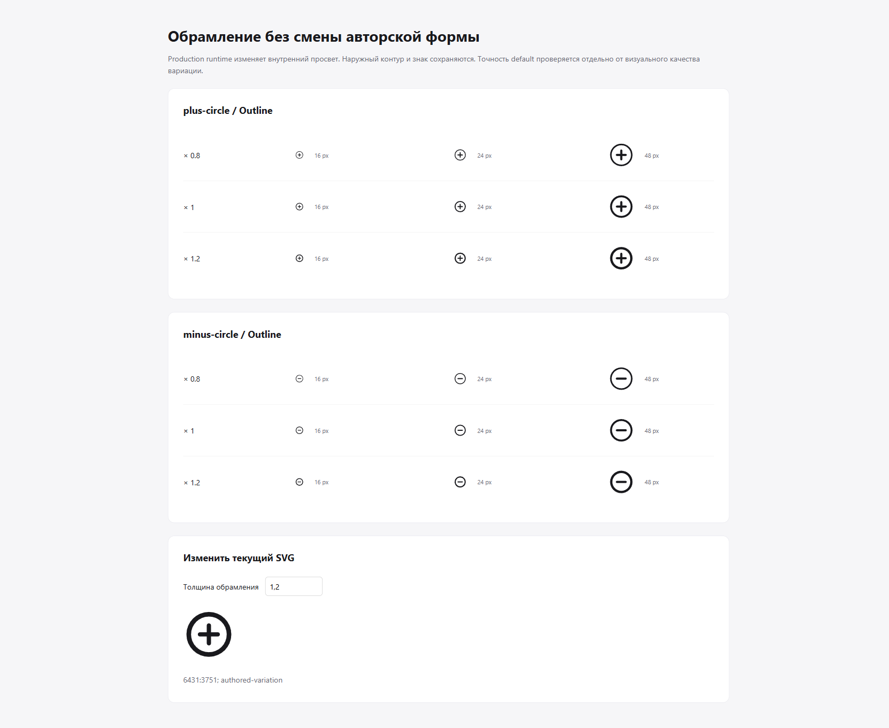

# Выборочный просмотр авторского обрамления

2026-11-02. Production source: `b654ac210ac5e2ab96c97203c2c5b91c5e1cded7`.
Два Outline masters Figma `2416636003859748575`: plus-circle `6431:3751`,
minus-circle `6431:4069`. Скомпилированные модули и их хеши закреплены в
[отчёте emitter](../../research/annulus-entrypoints-20261102.json).

Лёгкая browser-страница импортировала готовые `variations/<id>` и показала
их `glyph().svg` при 16, 24 и 48 CSS px, с `enclosureEmphasis` 0.8, 1 и 1.2.
Генератор геометрии страницы отсутствует. Полная сборка, нагрузочный тест и
benchmark на рабочей Windows машине не запускались.

SHA-256 изображения:
`208b60bbb10cdf8931f57c95249a3ed4db18442e939a5632290603b043ff20a7`.

При просмотре в натуральном масштабе оба знака узнаваемы; содержимое и наружный
силуэт сохраняют положение, меняется внутренний просвет. Значение 1 воспроизводит
авторскую форму. Запрос 2.6 вернул `VARIATION_OUTSIDE_DOMAIN`; предыдущий SVG
остался видимым. Это авторское наблюдение выбранных значений, не независимая
оптическая приёмка всего диапазона или проверка полного Observatory.

Filled, StyleProfile, optical size и движение изменённого обрамления здесь
не проверялись. Почти исчезающая стенка у нижней геометрической границы
не получает визуального допуска из этого просмотра.
