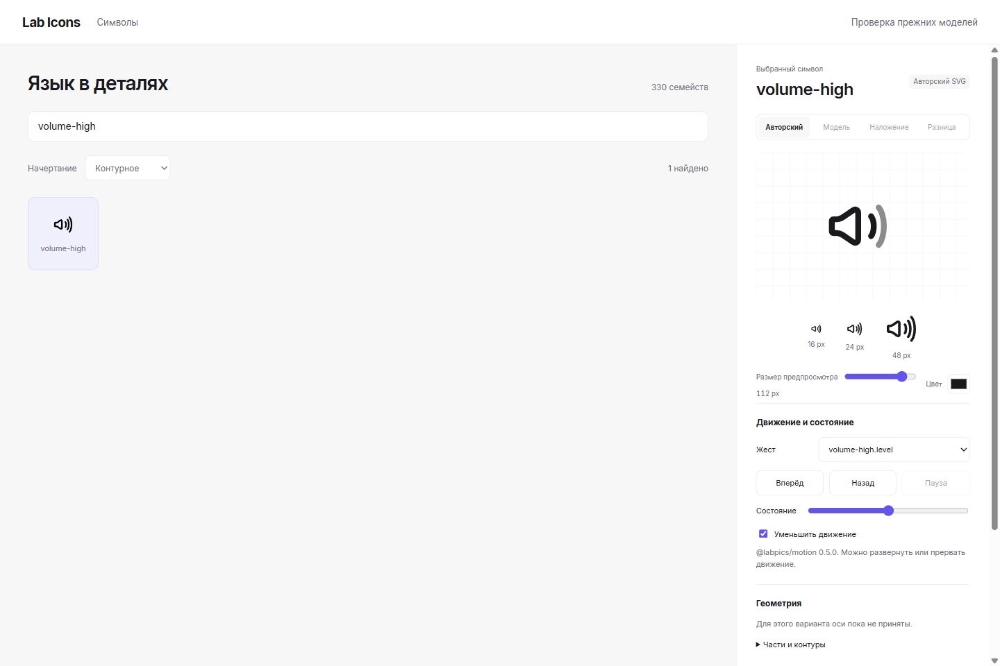

# Авторские состояния громкости

На 2026-11-01 семантический compiler `c64e6d25a7b47f552fe618614bea542b4d475722`
принимает `signal.levels` для `volume-high/outline`, `volume-high/filled`
и `volume-middle/filled`. Observatory и browser journey относятся к
`f990e45414e0a5aaeea40647fa5b5a14bcdda2a5`.

Авторская основа — Figma `LuaiBd4anRi4DMZayKAnY2`, версия
`2416636003859748575`, `lastModified=2026-11-01T01:18:02Z`.
Повторное чтение live REST в этой сессии подтвердило ту же версию и время.
Каждая декларация связана с node/master/path hashes через
[manifest](../../semantics/figma-baseline.json) и
[анатомию](../../semantics/author-anatomy.json). Figma не изменялась.

## Закон и физическая граница

Шкала включает целые авторские волны от ближней к дальней. Интервалы выводятся
из количества объявленных волн; в декларации нет координат, порогов или
отдельных копий геометрии. Неподвижный динамик, порядок `d` и локальная заливка
сохраняются. `restProgress=1` связывает slider с полной исходной позой.
Это opacity-состояние; Draw, mute/slash и morph между самостоятельными мастерами
не объявлены.

У `volume-middle/outline` внешняя волна — path 0 и небольшой cap path 3,
разделённые другими путями в z-order. Нельзя отбросить cap, считать его третьей
волной или обещать group opacity через отдельную opacity каждого пути.
[SVG 2, object/group opacity](https://www.w3.org/TR/SVG2/render.html#ObjectAndGroupOpacityProperties)
определяет групповую композицию через общий RGBA-слой. Поэтому этот вариант
сохраняет master и получает точный отказ состояния до подходящей композиции
и её render proof.

Публичный `VariableColorSymbolEffect` Apple
[описывает opt-in и cumulative opacity](https://developer.apple.com/tutorials/data/documentation/symbols/variablecolorsymboleffect.json).
[WWDC25, 337](https://developer.apple.com/videos/play/wwdc2025/337/?time=303)
отдельно связывает Variable Draw с draw-аннотациями. Эти первичные источники
подтверждают различие состояний слоёв и рисования; они не удостоверяют Lab Icons.

## Выполненные проверки

Core targeted suite прошёл: 33 tests для нового закона и прежних cycle/triad;
typecheck, syntax и diff checks прошли. Независимый ожидаемый уровень вычисляется
прямо из нормализованной шкалы и raw masters. Проверены середины/границы,
from=1, reverse/seek/reduced и точные отказы осей, Draw, чужой композиции и
разделённой волны. Валидация `restProgress` обнаруживает нечисловые и выходящие
за домен значения; старый sampler принимал `NaN` в этом поле.

Browser source journey прошёл 128/128. В трёх вариантах полный master стартует
с уровнем 1; при 0.5 ожидаемые волны равны `[1, 0.5, 0]` либо `[1, 0]`.
Admission обратной новой цели сохранил фактические opacity; reduced motion
принял последнюю цель. Динамик и авторские paths остались неизменными.
Source preview материализовал только шесть семейств, остальные существующие
source-only проекции сохранены. Это bounded функциональная проверка.

SHA-256 PNG: `9cff8c4ae24391c66a98a89ac3340fac795c52bb64b31bd38eb238f795216dec`.
Просмотр сохраняет узнаваемый силуэт и просвет динамика; sample-ряд показывает
неподвижные авторские формы в натуральных размерах. Полная оптическая приёмка
корпуса и всех промежуточных состояний остаётся открытой.

Full build/pack, installed consumer, performance и merge этого среза не
подтверждены. Их проверяет удалённый self-hosted путь; числа bytes/frame-time
из этого preview не выводятся. Новый закон сокращает повторное описание
сигнальной шкалы, но не заменяет конструктивную модель и оптическую квалификацию.
