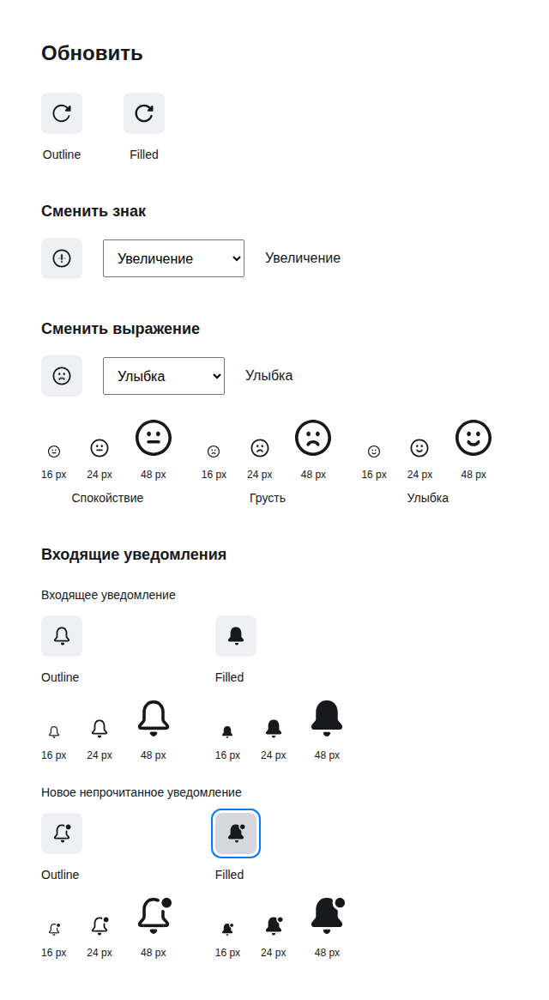

# Авторские символы в установленном Lab UI

## Schema 5: последний завершённый прогон

Self-hosted [run 41379836604](https://github.com/Labpics-Team/labui/actions/runs/41379836604)
завершился 2026-11-02T02:59:39Z. UI
`a00182aa6bce61f964fbee29426e235efeae2022`, Icons
`700f863f7cef3d7d17b3eadf29df699cdf144d4c`, Motion 0.5.0.
Основной UI CI `41379836720` прошёл; отдельный consumer delivery — **Нет**.
[Аутентифицированный receipt](consumer-20261102/schema5-a00182/receipt.json)
связывает report SHA-256, runner, архивы, 38 исходных материалов, 1361 artifact,
10 consumers и текущие 330 семейств/660 авторских вариантов.

Браузер остановился после 34 наблюдений на развороте многоточия; полный
schema5 и reduced-motion прогон не завершились. Настоящий Motion 0.5.0
[различил события](consumer-20261102/schema5-a00182/motion-admission-witness.json):
после видимого `p=0.2` вызов `get()` сохраняет `0.2`, но через 5 ms
`animate()` записывает продвинувшийся кадр старого playback
`0.20416666666666666`. Consumer уже скомпилировал новый `effect.from=0.2`.
Начальная геометрия и данные нового эффекта расходятся. Это требует исправления
admission потребителя и повторного браузерного прогона; отличие строк само по
себе не измеряет заметность скачка.

Selective status consumer теперь **9196 raw / 3821 gzip / 3110 Brotli bytes**,
прежде 13055 / 5517 / 4475 в том же consumer workload. Его бюджетный отказ
устранён. Остался 21 уникальный размерный отказ других artifacts/consumers;
полный список и неизменённые потолки сохранены в receipt. Сокращение размеров
не является измерением latency, frame time или памяти. Полная optical admission,
native CI, публикация npm и production-готовность остаются открытыми.

## Предыдущий успешный браузерный прогон

Self-hosted [run 41368364762](https://github.com/Labpics-Team/labui/actions/runs/41368364762)
проверил Icons `f2582fa32a48b7dd22322ebbbcfe16ad2719016e` и UI
`737a8300de2f03600752cda040f71f600f1eb292`. Измерение выполнено
2026-11-02T00:59:30Z: Linux x64, Node 22.19.0, Ryzen 9 5950X, 12 доступных CPU.
Точные версии, hashes и результаты сохранены в [receipt](consumer-20261102/receipt.json).

**Да:** браузерный consumer установлен из архивов и прошёл 76 наблюдений,
включая 32 случая уведомлений и 15 случаев выражений. Проверены авторские
Outline/Filled, состояния, reverse, newer occurrence, interruption, reduced motion
и доступные кнопки. Все 32 исходных материала связаны точными hashes.
PNG извлечены из ограниченных BEGIN/END packets с проверкой SHA-256;
изображения 16/24/48 просмотрены. Это приёмка представленных случаев.
Несохранённое состояние Desktop и оптическая приёмка всего Figma-корпуса открыты.

[Изображение reduced motion](consumer-20261102/reduce.png).

**Нет:** поставка не прошла численные потолки. 330 symbol declarations
получили повторный запрет variation; root исправил его в `a0f6b8e`, сохранив
публичные типы. Остальные 15 превышений записаны в receipt, включая новые
variation-модули, runtime и уведомления. Этот отчёт предшествует исправлению
declarations и `3873ce5`, поэтому не подтверждает их packed qualification.
Бюджеты не изменены.

| Реальный consumer | Raw / gzip / brotli, bytes |
|---|---:|
| Один прежний статический SVG | 637 / 394 / 353 |
| Авторский статический `time` | 1155 / 583 / 512 |
| Один авторский `glyph`, `alert` | 11120 / 3108 / 2589 |
| Рендер и переход `status-circle` | 13055 / 5517 / 4475 |
| Полный IR, явный opt-in | 853553 / 214736 / 161043 |

Это однократные измерения размера exact consumer entries из receipt;
comparative latency, frame time, memory и доверительные интервалы не измерялись.
Static и symbol entries не удержали полный IR. Полный `component.js` имеет
58041 raw / 9290 gzip bytes и соблюдает прежний потолок; размер полного модуля
не является стоимостью отдельного импортированного экспорта.

**Не было:** полная optical/variation приёмка, native Windows/macOS, npm release
и квалифицированный сравнительный benchmark. Новый consumer закреплён на
`3873ce5` в UI `d0bd183`; его результат требуется отдельно. Миссия остаётся активной.
