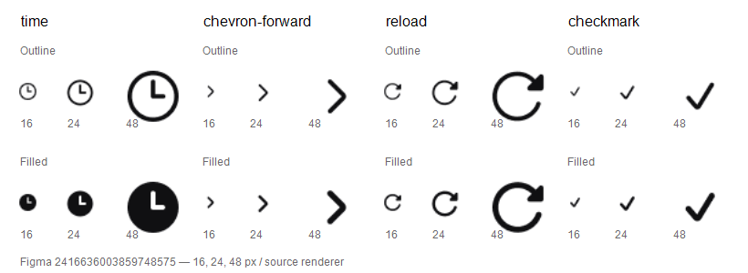

# Авторская основа Lab UI v2.1

На 2026-11-01 в актуальной Figma находятся **330 семейств в двух независимых
начертаниях: 660 компонентов**. На baseline `03a4ca3` были 238 имён;
все сохранены в новом снимке, добавлены 92.
Новые имена перечислены в `comparison.addedFamilies` машинного манифеста.
Исторический размер репозитория не ограничивает новый авторский корпус.

## Источник и фиксация

- Файл: [🧪Lab UI (v2.1)](https://www.figma.com/design/LuaiBd4anRi4DMZayKAnY2),
  ключ `LuaiBd4anRi4DMZayKAnY2`.
- Версия: `2416636003859748575`; `lastModified`: `2026-11-01T01:18:02Z`.
- Страница Icons: `4045:632`; общий фрейм Lab icons: `6431:3712`.
- Filled: `6397:2241`; Outline: `8513:1000`.
- SVG экспортированы штатным Figma REST renderer с закреплённой версией,
  `contents_only=true`, `use_absolute_bounds=true`, `svg_simplify_stroke=false`.
- Снимок геометрии двух фреймов: SHA-256
  `622f0ccb116c0dad940b6d11b590ca78952ee460c42cad69f8c3d0cc8353c967`.

Неизменяемые SVG находятся в
[`masters/figma/2416636003859748575`](../../masters/figma/2416636003859748575).
[`semantics/figma-baseline.json`](../../semantics/figma-baseline.json) связывает
каждый вариант с node ID, хешем авторского узла, исходным SVG и результатом
нейтральной нормализации. Это авторские мастера; рабочие проекции компилятора
должны строиться из них. Каталог конструктивных моделей отдельно подтверждает,
какие возможности прошли проверку против этой основы.

## Доступ

Figma Console MCP проверен. У дочерней сессии Desktop Bridge на порту 9230
не был подключён; у основной сессии был открыт Pactis. REST-инструменты Console
не получили `FIGMA_ACCESS_TOKEN` в своей среде процесса. Эти отказы не означали
отсутствия доступа к файлу.

Поддерживаемое Figma-приложение прочитало страницу и компоненты. Официальный
REST API получил действующий ключ из уже настроенной среды PowerShell и позволил
прочитать версию, геометрию и экспортировать весь корпус. Значения ключей,
временные URL скачивания и сведения о других страницах в артефакт не включены.
Файл Figma и его компоненты не изменялись.

## Коррекции, которые прежняя модель не сохраняет

У `time` есть конкретный геометрический контрпример. В репозитории на
`03a4ca3` наружный круг имеет радиус 11, от x=1 до x=23. В авторской версии
его диаметр 21, от x=1.5 до x=22.5. У Outline верхняя опорная точка руки
изменилась с y=5.74 на y=6.05273; у Filled — с y=5.87 на y=6.25977.
Начертания имеют собственные контуры и положения руки. Единая грубая
поправка размера или старый общий pivot не воспроизводят эти изменения.

Сравнение текстовых геометрических fingerprint показало 3 совпадающих и
473 различающихся варианта среди прежних 476. Этот fingerprint чувствителен
к синтаксису path и **не измеряет визуальное отклонение**. Число 473 не означает
473 подтверждённых оптических дефекта. Вывод о несовместимости старой модели
`time` основан на конкретных размерах и рендерах.

## Нормализация и просмотр

Официальные SVG содержат нейтральные группы с `id` и `data-node-id`.
Прежний импорт отклонял все восемь проверенных экспортов четырёх семейств.
Обновлённый intake удаляет только такие сбалансированные группы и метаданные.
`d`, порядок path, локальные `fill-rule` и `clip-rule` сохраняются.
Группы с transform, opacity, paint, cascade, mask или filter отклоняются.
У всех 660 захваченных SVG нормализация прошла без отказов; строковые данные
path и порядок совпали с исходными экспортами.

Figma отдельно отрендерила `time`, `chevron-forward`, `reload` и `checkmark`
в Outline/Filled при 16, 24 и 48 px: 24 растровых экспорта. Ниже они размещены
без масштабирования и повторного рендеринга.

SHA-256 изображения:
`b468e581b462d9b3461e2d6781d3ff5135a3d333ac59ba9b002ea80886b3b74a`.

Просмотр этих восьми вариантов подтверждает сохранённые силуэты, узнаваемость,
контрформы и различие веса там, где оно авторски задано. Это выборочный просмотр.
Полная оптическая приёмка 660 вариантов, осей, профилей и движения остаётся
открытой; наличие мастеров и успешный parser не закрывают её.

## Официальные контракты

- [Figma REST file endpoints](https://developers.figma.com/docs/rest-api/file-endpoints/):
  закрепление версии, `geometry=paths`, SVG/PNG export и границы node.
- [Figma OpenAPI](https://github.com/figma/rest-api-spec/blob/main/openapi/openapi.yaml):
  параметры экспорта и явный отказ отсутствующему renderable node.
- [SVG 2: группы](https://www.w3.org/TR/SVG2/struct.html#Groups):
  группа может менять наследуемые свойства; без проверки её нельзя удалять.
