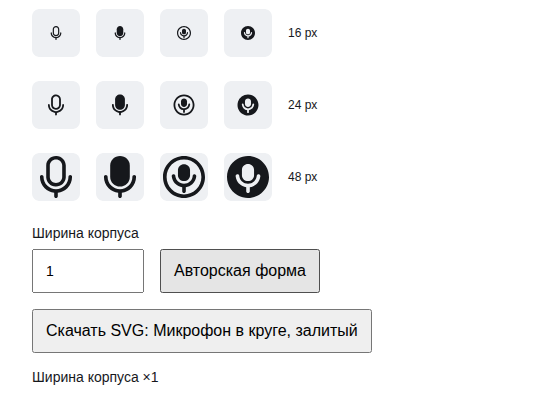
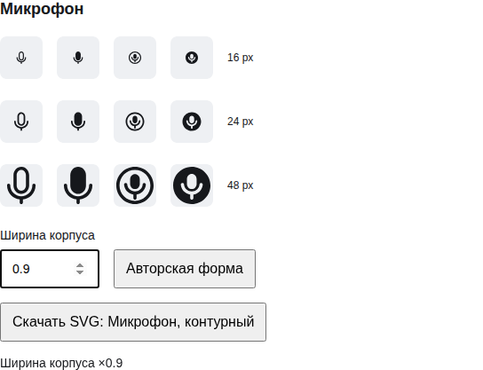

# Оптическая ширина микрофона в установленном Lab UI

**Diátaxis:** reference. Проверены настоящие PNG из [успешного self-hosted consumer](https://github.com/Labpics-Team/labui/actions/runs/41519738213/job/125532379401), завершённого 2026-11-02 в 20:57:46 UTC. Icons: `44f9c10f6d3349ce061b56497cafc66b901f5a81`; Lab UI: `06b2df1cb043175cb48a443eba377e1227e740c9`. Исходные masters — сохранённая Figma-версия `2416636003859748575` файла `LuaiBd4anRi4DMZayKAnY2`.

Независимый reviewer посмотрел `mic` и `mic-circle`, Outline/Filled, при 16/24/48 px и `bodyWidth` 1/0.9/0.8. Сначала — натуральный масштаб, затем два прохода увеличения для формы, просветов, веса и маленьких размеров. **PASS в этой области**, findings=[]. Капсула сохраняет вытянутый характер; стойка и круг остаются опорой. Открытый counter Outline mic и отрицательный корпус Filled mic-circle читаются даже при 16 px. Различия apparent width независимых Outline/Filled присутствуют уже в авторском baseline и не требуют механического уравнивания.

PNG изменённой ширины побайтно совпадают с authenticated log packets и [visual receipt](microphone-consumer-06b2df1-20261103/visual-receipt.json). Default вырезан из проверенного `result/no-preference.png`: x=16, y=7378, width=544, height=417; reviewer подтвердил совпадение декодированных пикселей. Заголовок crop немного обрезан, все образцы видны. [Полный независимый отчёт](microphone-consumer-06b2df1-20261103/optical-review.json) сохраняет исходные пути, hashes, метод и ограничения; PNG скопированы без изменения байтов.

Снимки ширины в reduced motion имеют те же hashes. Это равенство статической позы; оно не устанавливает качество новой анимации. Проверка относится к светлой поверхности, указанным размерам и трём значениям ширины. Между ними остаётся действующий геометрический допуск compiler; просмотр конечных образцов не заменяет его.

Этот результат не закрывает новое сравнение с `question-circle`/`play-circle` в Lab UI `e3227a2`, source-state transitions, иной DPR/фон, весь корпус, StyleProfile или полные weight/opsz. Для них сохраняются самостоятельные условия активного r14. Exact-head CI и Laborant, merge и npm publication также остаются отдельными открытыми гейтами.
