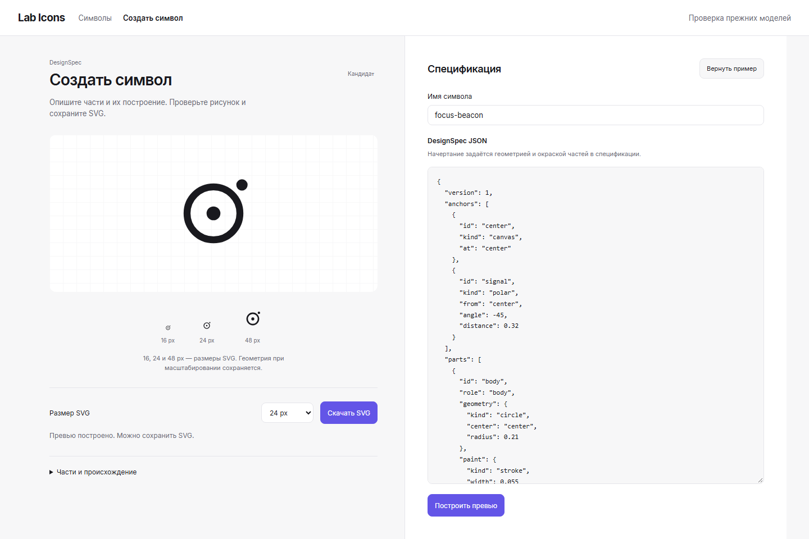

# Публичная DesignSpec: source и граница поставки

Первый compiler freeze: `e12fa37792efe703bd22ab41dcdcde7d556b466c`.
Текущий source/browser freeze: `0405dd4a0766cd01df3859428e21c095f5f1096f`.
Текущий срез связывает существующий parser/lowering с общим SVG assembler.
`compileDesignSpec` сохраняет IDs, роли, порядок, topology, именованные якоря,
декораторы и ограничения. Provenance имеет `kind: design-spec`, версию 1,
SHA-256 нормализованной спецификации и состояние `candidate`.

Новый знак не заменяет Figma masters. `size` задаёт размеры экспорта, а variant
выбирает независимо составленную автором спецификацию; автоматическая оптика
и morph-admission из них не следуют. Несовместимые композиции, raw path,
необъявленные поля, `null` вместо optional values и разреженные массивы имеют
точные отказы. Изменения parser закрепляют эти правила у единственного владельца.

## Проверки первого compiler freeze

- 45 source-тестов и TypeScript проходят на source freeze.
- Два независимых source reviewer PASS: публичная граница и контракт/последствия
  эволюции. Дополнительно boundary reviewer выполнил 23 самостоятельных probes.
- Literal tutorial и три композиции показаны в Chromium 156 в размерах 16/24/48.
  [Render](public-authoring-20261101.png), SHA-256
  `29347d28273bdcedfc92ff61df598aa4014a2c5944fc626521ad10f51904fe03`.
- 53 bounded проверки release/package fixtures и remote consumer procedure
  проходят после добавления физического authoring export и его деклараций.
  TypeScript, docs drift, repo contract, syntax и diff check проходят.

## Создание символа в Observatory

В том же Observatory доступна `authoring.html`. Пользователь редактирует JSON,
строит превью публичным `compileDesignSpec`, видит SVG при 16/24/48 px и скачивает
текущий результат. Tutorial служит исходным примером. `size` меняет размеры SVG;
фиктивных optical/profile controls нет. Неверный ввод очищает прежнее превью и
экспорт. Отдельное нажатие «Построить превью» показывает результат или ошибку и
переводит фокус к ней; переход не использует плавную прокрутку.

[Узкий viewport 390×844](authoring-playground-narrow-20261101.png) снят с
`fullPage: true`. Отдельный keyboard feedback path проверен при 390×640 и с
reduced motion. Оба изображения относятся к source freeze
`0405dd4`, Chromium `156.0.8078.4`. Это actual authoring page с ограниченным
bundle публичных исходников; каталог использует ранее построенные Observatory
assets. Полная сборка и установленный пакет здесь не проверялись.

[Source identity](authoring-playground-source-20261101.json) закрепляет девять
compiler inputs, clean SHA и hash tutorial.
[Browser observations](authoring-playground-journey-20261101.json) сохраняют
реальные bbox/path length/paint, размеры, семантические части, refusal и download.
Два изолированных reviewer дали PASS для этого source SHA: пользовательский путь
и граница compiler/tooling. В scope не входила полная оптическая приёмка корпуса.

SHA-256 широкого изображения:
`3a8253de39fda351a36af51681f75127b718098c504f63ef8a0209764bd0e4e8`.
SHA-256 узкого изображения:
`61080e002a2a89b534e0056024207f08e62ea38bbc18173a98aa00632e22e7be`.

## Открытый consumer gate

Canonical build и release projection включают только `./authoring` и его точную
private declaration dependency. В remote benchmark job добавлен consumer после
замеров: он исполняет public tutorial из установленного tarball, проверяет
strict NodeNext types с четырьмя отрицательными controls, runtime-отказы,
повторяемость, экспортированный SVG, доступное имя и натуральные размеры.
Готовый SVG bundle содержит только один статический literal input.

Этот remote consumer ещё не выполнялся на срезе. Full build, packed install,
exact-head CI, независимое installed package review, merge и публикация не считаются
пройденными на основании source-проверок. Новая грамматика не закрывает
prospective author cohort, полный конструктивный корпус или optical admission.
