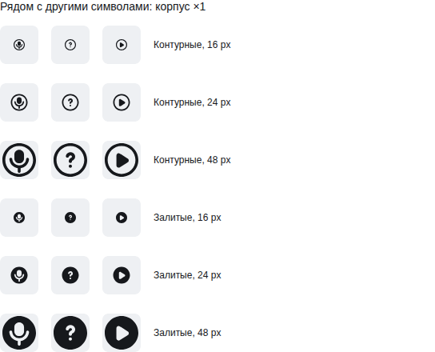
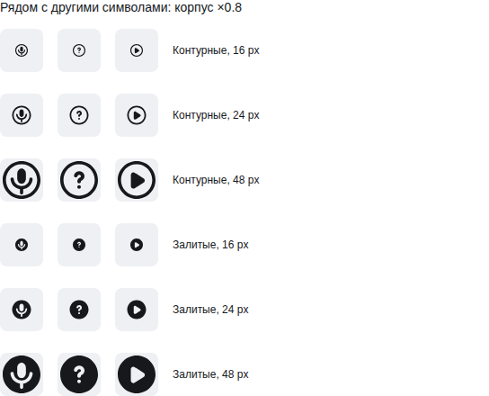

# Авторские состояния и соседние символы в Lab UI

**Diátaxis:** reference. [Self-hosted consumer](https://github.com/Labpics-Team/labui/actions/runs/41530330458/job/125568562377) завершился SUCCESS 2026-11-02 в 22:07:54 UTC. Точная пара: Icons `2bf18f9903511d5b0ed703118e7134188253571a`, Lab UI `e3227a2fabc9136997f58cf710076bce614940df`. Linux/X64, Node 22.19.0, Chromium 140.0.7339.186, Ryzen 9950X, восемь доступных CPU.

Установленный внешний consumer прошёл 264 browser records и 26 отрицательных type controls. Четыре source-state группы microphone/visibility Outline/Filled сохраняют точные on/off masters и исполняются публичным Lab Motion. Проверены reverse/interruption/newer state, reduced motion, DOM continuity, native кнопки, видимый SVG export и точные отказы. SVG oracle проверяет полный tree, raw/effective paint, физический viewport и CTM; положительные browser controls прошли.

Независимый оптический просмотр сравнил соседние mic-circle/question-circle/play-circle Outline/Filled при 16/24/48 px и ширине 1/0.8. **PASS в показанной области**, findings=[]. Обрамление, вес круга и опора согласованы; сужение освобождает просветы и сохраняет капсулу, держатель и отрицательный корпус. Оба motion modes дают побайтно одинаковые снимки этих статических поз. [Отчёт](source-consumer-e3227a2-20261103/optical-review.json) и [visual receipt](source-consumer-e3227a2-20261103/visual-receipt.json) сохраняют hashes, метод и ограничения.

## Установленный footprint

| Consumer | Raw B | gzip B | brotli B |
|---|---:|---:|---:|
| Один static import | 637 | 394 | 353 |
| Microphone state, Outline | 9334 | 3481 | 2863 |
| Microphone state, Filled | 8595 | 3126 | 2585 |
| Visibility state, Outline | 11802 | 4725 | 3889 |
| Visibility state, Filled | 7887 | 2926 | 2468 |

Full measurement покрывает 1443 artifacts и 24 consumer scenarios, policyViolations=[]. [Приёмка первых policies](source-consumer-e3227a2-20261103/policy-admission.json) добавляет десять artifacts и шесть scenarios ровно по измеренным raw/gzip, без запаса. Все 2902 прежних max-поля и остальные поля существующих записей сохранены без изменения, включая entries, modules и forbiddenNeedles. Временные показатели этим запуском не сравнивались.

Исходные [measurement JSON в gzip](source-consumer-e3227a2-20261103/platform-measurement.json.gz) и [consumer receipt JSON в gzip](source-consumer-e3227a2-20261103/receipt.json.gz) восстановлены из полных BEGIN/CHUNK/END CI log packets. После распаковки их SHA256 соответственно `5152bf900c14bfd02afcb8fa4c23a6864122c0d22a053b9f92ca0f8cf4901fd7` и `4dcaddb845b75ba3c82124efecf45c2d6cb9efcf32bfb0057958a4d9e7c15639`; identities и полный набор chunks проверены. Receipt содержит hashes неизменённого consumer harness и установленных artifacts.

Это приёмка конкретного source-pack consumer и показанного оптического соседства. Она не заменяет required Icons/UI CI и Laborant точного head, merge, npm publication, иной DPR/тему, полный корпус, StyleProfile, weight/opsz, BENCH-01 или mixed-version rollback. Новое собственное движение ширины и оптическая траектория timer требуют своих controls.
