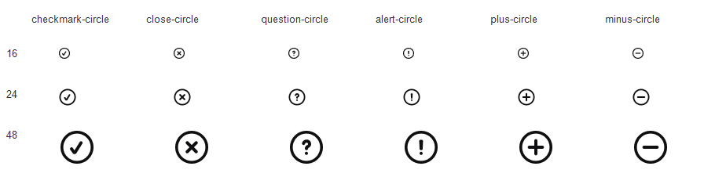

# Авторские круглые знаки при 16, 24 и 48 px

Официальный Figma REST renderer экспортировал шесть Outline-компонентов
Lab UI v2.1 в закреплённой версии `2416781108246633005`. Полные документы
этих узлов с `geometry=paths` совпадают по SHA-256 с сохранённой основой
`2416636003859748575`. Файл: `LuaiBd4anRi4DMZayKAnY2`.

[Receipt](status-circle-20261101/author-renders.json) сохраняет время,
node IDs, хэши полных документов, raw masters и каждого из 18 PNG.
Размер каждого PNG проверен по IHDR. Контактный лист вставляет исходные
пиксели через `Graphics.DrawImage` с одинаковыми source/destination pixel
rectangles и `GraphicsUnit.Pixel`; векторная геометрия не перерисовывалась.

Во всех трёх размерах круглая оболочка сохраняет одинаковый вес и баланс.
Галочка, крест, вопрос, восклицательный знак, плюс и минус различимы;
их индивидуальные пропорции и просветы сохранены. Этот просмотр относится
к шести авторским Outline-мастерам. Переходы, generated overlay, Filled,
другие размеры, оптические оси и полный корпус здесь не квалифицированы.

Console MCP на момент чтения подключён только к Pactis. Запрос целевого
Lab UI v2.1 вернул `websocket_file_not_connected`. REST-инструмент Console
не получил token в своей среде процесса; официальный API доступен через
уже настроенную PowerShell-среду. Несохранённое состояние Desktop
не наблюдалось. Figma-файл и компоненты не изменялись.
