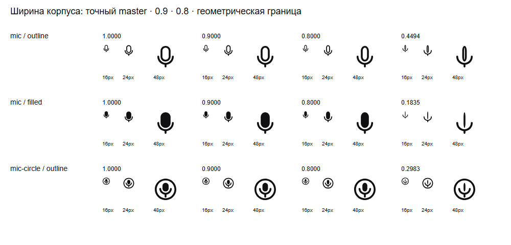

# Оптическая область ширины корпуса

**Diátaxis:** explanation. Проверено 2026-11-02. Закон `capsule.width` меняет
горизонтальную ширину корпуса при неизменных высоте, стойке, обрамлении и
авторских C-операндах по вертикали. Это контекстная вариация формы; параметр
`bodyWidth` не задаёт размер отображения.

## Наблюдение и решение

Источник — Figma `LuaiBd4anRi4DMZayKAnY2`, сохранённая версия
`2416636003859748575`. Артефакт до ограничения области:
`10a994686e34e4d1c6b03af0eeb879e6c55bd029`. Независимый визуальный просмотр
проверил три допущенных master: mic Outline/Filled и mic-circle Outline.
Ширины `1`, `0.9`, `0.8` прошли просмотр при 16/24/48 px, DPR 1.
При прежних геометрических минимумах корпус воспринимался как вертикальная
линия; основная масса смещалась к стойке или окружности.

| Master | Прежний геометрический минимум | Публичный минимум |
|---|---:|---:|
| mic Outline | 0.4493557931633908 | 0.8 |
| mic Filled | 0.18349372043712373 | 0.8 |
| mic-circle Outline | 0.2983006804569976 | 0.8 |

SHA-256 изображения:
`e00f9cc60fb56a6ac35e94fafc0b5cdc2f7d1c9fdf9b31ec67a8ca4b77b7b3d5`.
Полученный файл сохранён без изменения байтов. Первичный локальный экземпляр:
`E:\AgentWork\microphone-width-evidence-20261102\sheet.png`.

Компилятор владеет одной политикой `lab-ui-v2.1-capsule-width`, версия 1.
Она задаёт общий предел `0.8` для текущего авторского стиля и связывает его
с источником и рассмотренным артефактом. Публичный минимум равен максимуму
геометрического минимума и стилевого предела. Координаты и отдельные значения
для конкретных иконок в этой политике отсутствуют.

Полный геометрический сертификат по-прежнему покрывает интервал от исходного
численного минимума до `1`, поэтому покрывает и более узкую публичную область.
Его `geometricDomain` остаётся в build evidence; runtime получает публичную
область, стилевой receipt и digests. Версия, источник, политика и evidence
участвуют в hash скомпилированного пакета. Другой сохранённый источник получает
`STYLE_SOURCE_MISMATCH` до новой оптической квалификации.

## Проверка переноса

До исправления три regression-теста завершились ошибкой
`expected function to throw an error, but it didn't`: прежние минимумы
принимались через настоящий runtime. Здоровые `0.8`, `0.9`, `1` в том же
тесте выполнялись успешно. После ограничения прежние минимумы и ближайшее
binary64-значение ниже `0.8` получают `VARIATION_OUTSIDE_DOMAIN`.

Девять SVG при `0.8`, `0.9`, `1` побайтно совпали с исходным артефактом.
[Сравнение](capsule-optical-domain-20261102.json) сохраняет отдельный hash
каждого результата. Публичный generated module принимает `0.8` и отказывает
при `0.79`; обычный статический импорт не получает код или данные вариации.
Exact default, контрформа, толщина боковых стенок, якоря и неизменные части
проверяются существующими focused-тестами.

## Область вывода и альтернативы

Принятая непрерывная инженерная область опирается на просмотр концов `0.8/1`,
внутренний образец `0.9` и непрерывный геометрический сертификат. Просмотр
трёх значений не является психофизическим доказательством каждого промежуточного
положения, каждого DPR, устройства или расстояния просмотра. При переносе
на иной авторский стиль требуется его собственная квалификация.

Оставить полный численный интервал нельзя: он воспроизводит наблюдённую
потерю узнаваемости. Ограничение только в Observatory не защищает внешний
consumer. Отдельные пределы по именам иконок добавили бы вторую настройку
того же стилевого правила. Запрет всех вариаций потерял бы уже просмотренные
полезные значения. Общая политика у компилятора устраняет этот класс ошибки
на всех существующих публичных входах без нового сервиса или runtime-каталога.

## Первичные внешние источники

Повторно прочитаны 2026-11-02:

- [OpenType 1.9.1, opsz](https://learn.microsoft.com/en-us/typography/opentype/spec/dvaraxistag_opsz):
  пропорции, толщина и детали зависят от рисунка и условий просмотра;
  положительный численный диапазон не определяет оптическую пригодность.
- [OpenType Axis Guidance](https://github.com/Microsoft/OpenTypeDesignVariationAxisTags/blob/master/Proposals/GuidanceForAxisDetails.md):
  отдельный шрифт использует поддиапазон общего диапазона оси; смысл чисел
  и пределы должны быть явно определены владельцем дизайна.
- [Apple, Creating custom symbols](https://developer.apple.com/documentation/technologyoverviews/custom-sf-symbols):
  совпадение количества путей и control points разрешает интерполяцию;
  отдельные авторские варианты и направляющие сохраняют особенности дизайна.
  Само условие интерполяции не оценивает качество нашей узкой капсулы.
