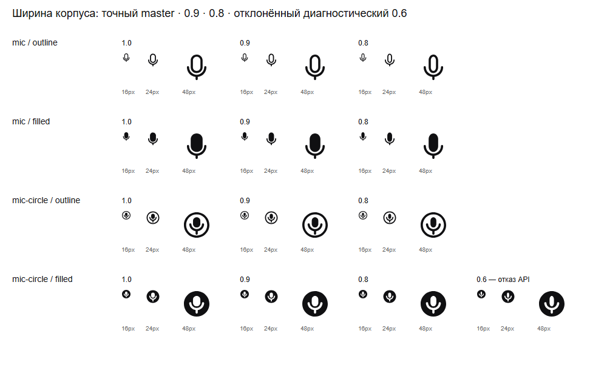
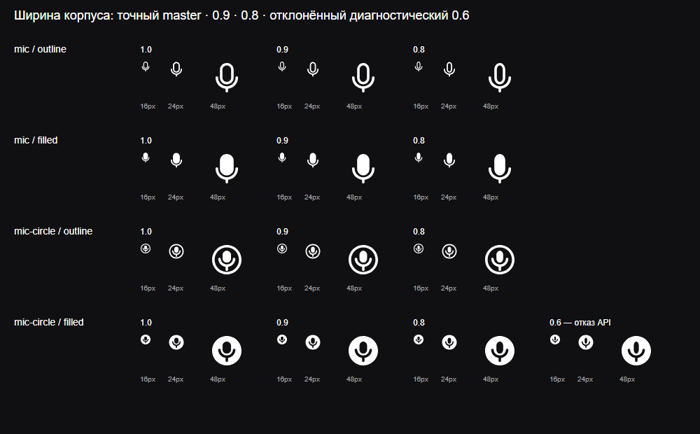

# Отрицательный корпус микрофона внутри круга

**Diátaxis:** explanation. Срез на 2026-11-02. `capsule.width` теперь сохраняет
не только положительный корпус, но и отрицательный корпус Filled `mic-circle`.
Ширина изменяет форму корпуса по горизонтали; высота, стойка и круг сохраняются.
Проверка реализации выполнена. Независимая геометрическая и оптическая приёмка
этого среза остаётся открытым гейтом до доставки.

## Источник и сохранённая форма

Авторский источник: Figma `LuaiBd4anRi4DMZayKAnY2`, версия
`2416636003859748575`, компонент `6413:30`, Vector `6429:31`.
Master: `masters/figma/2416636003859748575/Filled/mic-circle.svg`.
SHA-256 master:
`a2b2c05074d1a8b791e1a31962c7c57658184cf7b16b737efedbed2cf792d8a7`.
Fingerprint полного нормализованного path:
`2ab6c70b6036f654a3ef5f332a2a283509dadab0ccabd01f324a0ab3b7950ed9`.

В master одна `evenodd` заливка с тремя закрытыми contours. Аннотация
явно адресует их как `microphone-enclosure`, `microphone-support` и
`microphone-body`. Первой части принадлежит роль `container`, двум внутренним
частям — существующая роль `counter`. Их `fillRule:null` означает, что части
не рисуются отдельными слоями. Общая composition сохраняет `evenodd`.
Стабильные IDs выходят в Glyph IR; индексы contours остаются в build contract.

`bodyWidth:1` возвращает source object без копии. Concatenation literal fragments
побайтно восстанавливает исходный `d`. Статический `filled` export также
сохраняет исходный SVG. При изменении ширины только `microphone-body` получает
новый `d`; остальные части сохраняют прежние объекты и все исходные координаты.
SVG продолжает содержать один path, без mask и скрытых фоновых заливок.

## Геометрический допуск

Смысл отрицательной части не выводится из winding. Компилятор сначала
доказывает простоту каждого contour, отсутствие пересечений и вложенности
отверстий, а затем их нахождение внутри оболочки. Используется ограниченный
язык ровно четырёх монотонных cubic сторон без дополнительного closing edge.
Их endpoint polygon вписан
в оболочку; каждый control point отверстия должен лежать строго внутри этого
polygon. Convex hull property переносит условие на всю кривую.

Отдельный Bézier получает монотонную проекцию. Соседние кривые имеют разделяющую
прямую через общий endpoint; несоседние границы отделяются точными рациональными
Bernstein hulls. Для невложенности у каждого отверстия есть endpoint вне
control bbox другого. Контуры, для которых достаточный сертификат не получен,
отклоняются явно. Это проверяемый поддержанный язык, не универсальный SVG solver.

Тот же build-only владелец hull proof затем отделяет движущийся корпус от
стойки и оболочки на всём width-интервале. Все Y-операнды сохраняются; X-операнды
изменяются одной положительной affine map вокруг центра самого корпуса.
Для отрицательного корпуса минимальный span следует из общего clearance
`0.799992`, а не диаметра терминала положительного штриха `1.8`.
Полный build proof сохранён в [данных среза](negative-capsule-optical-domain-20261102.json).
Runtime получает precompiled controls, rates и digests; arbitrary path parsing
и поиск семантических частей при каждом render отсутствуют.

## Оптическая область

Отдельная политика `lab-ui-v2.1-negative-capsule-width`, версия 1, ограничивает
публичную ширину диапазоном `0.8…1`. Прежняя положительная политика и её три
master остаются неизменными. Собственные negative renders наблюдались при
16/24/48 px, DPR 1, в светлом и тёмном окружении. Браузер: Chromium
`156.0.8078.4`, Playwright `1.64.1`, viewport `1000×620`.

SHA-256 светлого изображения:
`709df0aa064be9525a1dfd5a48d0f8145df5924a7963b859cc3f04c510b4aa0e`.
SHA-256 тёмного изображения:
`21c957bc6be1f9e7a8d2eba7155a0a2a9657817eaff5c13c6b18d6c32b71d314`.
Первичные SVG, capture script и данные сохранены в собственном каталоге
`E:\AgentWork\negative-microphone-width-evidence-20261102`.

Последняя колонка — диагностический `0.6`, построенный из тех же coefficients.
Публичный API отказывает в этой ширине. При 16 px корпус уже теряет массу,
а при 48 px выглядит заметно тоньше стойки. Значения `0.8/0.9/1` сохраняют
различимый вертикальный корпус. Это результат ограниченного просмотра,
не доказательство для всех дисплеев, DPR, соседей и промежуточных ширин.
Независимое решение по допустимой оптической области требуется перед merge.

## Контрпримеры и выбор реализации

Пересекающиеся `evenodd` отверстия заполняют своё пересечение, вложенные —
оставляют внутренний остров. `mask-subtract` вычисляет union(base) минус
union(subtractors), поэтому такая замена меняет рисунок. Эти случаи, открытые
contours, переставленные/пропущенные индексы, relative `m`, неверные роли и
устаревший master имеют положительные контроли и точные отказы в focused tests.

Масштабировать целый символ проще, но это меняет круг, стойку и их оптический
вес. Независимые положительные layers теряют смысл отверстий. Runtime SVG
parsing добавляет повторную работу и заново угадывает уже известную анатомию.
Полный solver наподобие CGAL допускает более широкие Bézier arrangements;
его рациональные controls и алгебраические intersections потребовали бы
отдельной реализации и toolchain. Текущий закрытый язык использует уже
существующий точный build proof и typed refusal за его пределами.

Вариативный SVG поддержан. Независимое opacity/motion воздействие на отверстие,
Lottie и SF Symbols этим срезом не объявляются. Внешний consumer получает
стабильные IDs, роль `counter` и общую composition без знания contour indices.

## Первичные источники

Прочитаны 2026-11-02:

- [SVG 2, fill-rule](https://www.w3.org/TR/SVG2/painting.html#FillRuleProperty):
  parity определяется по всем subpaths одной заливки; winding сам по себе
  не назначает семантическую отрицательную часть.
- [SVG 2, paths](https://www.w3.org/TR/SVG2/paths.html):
  относительный moveto зависит от предыдущей позиции; отдельный literal fragment
  не должен менять начало координат.
- [CGAL 6.2, Bézier curve traits](https://doc.cgal.org/latest/Arrangement_on_surface_2/classCGAL_1_1Arr__Bezier__curve__traits__2.html):
  Bernstein representation с рациональными control points и алгебраическими
  intersections; применимость общего solver шире принятого достаточного языка.
