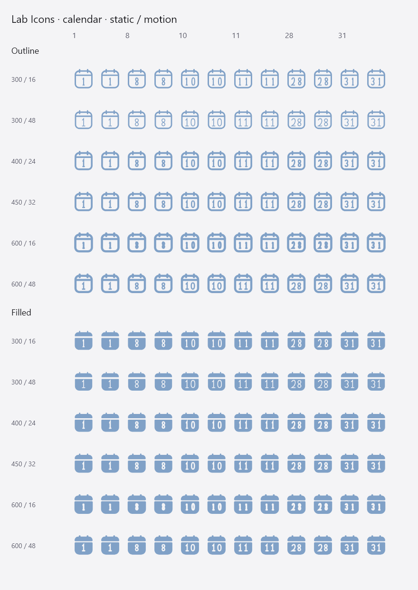

# Native calendar: проверка 17 ноября 2026

Проверен Compose renderer с календарным форматом 5 поверх общего web source
`899118c` (общий HEAD до native commit — `44439b9`). Дата задаётся через
`kotlin.time.Instant` и именованную IANA-зону; цифры, stroke, интервал и оболочка
поступают из общего числового пакета. Локальный Maven artifact:
`pics.lab:icons-compose:0.3.0-calendar-20261117.2`.

## Наблюдаемый результат

Все 24 `desktopTest` прошли: 0 failures, 0 errors, 1.234 s суммарного времени
тестов. Gradle test + Maven publication завершились за 14 s.

- 110 независимых web-samples проверили координаты десяти цифр, толщину stroke
  и интервал на девяти опорах и двух промежуточных положениях осей.
- 108 сочетаний дня, варианта и оптики дали одинаковые bitmap static/motion.
  Tint с alpha 0.55 применился один раз; вычитание Filled сохранило белый фон.
- Проверены midnight, leap day и оба перехода DST, UTC/Los Angeles/Tokyo,
  отказ неизвестной зоне и безымянному UTC offset, отсутствие скрытых часов.
- Смена дня сохранила выделение и оболочку, прерывание продолжило видимую
  прозрачность, disposal завершил активное движение. Покрытие слоя не зависело
  от порядка частей при crossfade.
- Реальные compiler fixtures форматов 1…4 декодировались с прежними defaults.
  Формат 5 принял открытый stroke и отверг открытый fill.

Отдельная consumer Gradle-сборка получила опубликованный Maven artifact и
самостоятельный Kotlin-экспорт plus-circle. Headless-проверка завершилась за
14 s: существующий сценарий часов и 72 пары календаря static/motion,
сохранение controller/date/selection при рекомпозиции, прерывание и disposal.



PNG осмотрен: дни 1/8/10/11/28/31, Outline/Filled, оптика 300/16, 300/48,
400/24, 450/32, 600/16, 600/48. Размер каждого Icon — 48 dp, tint alpha — 0.55.
Обрезанных цифр или оболочек нет; рисунки внутри каждой пары совпадают.
Размер изображения — 880 × 1240; SHA-256:
`b8e69afc4d99f2b221d8516fb1c695c9b18f4186f64470f6668a6d191cccc46e`.

Все локальные проверки рисовали в bitmap без окна, desktop capture или звука.
Android и iOS в этом прогоне не компилировались. Версия `.2` — локальная
development-публикация, не публичный выпуск.

## Повторить из корня репозитория (PowerShell)

Требуются Node dependencies репозитория и JDK 21. Генерация использует принятые
masters без `--preview`. Команды выполняются последовательно.

```powershell
$calendarRepo = (Get-Location).Path
./native/compose/gradlew.bat -p native/compose desktopTest publishDesktopPublicationToDistributionRepository publishKotlinMultiplatformPublicationToDistributionRepository '-PpublicationVersion=0.3.0-calendar-20261117.2' "-PpublicationRepository=$calendarRepo/native/compose/build/calendar-repository" --console=plain
node scripts/export-native-symbols.mjs --symbol plus-circle --package pics.lab.icons.consumer.generated --output native/compose/consumer/build/exported-calendar
./native/compose/gradlew.bat -p native/compose/consumer run --args=--headless '-PiconsVersion=0.3.0-calendar-20261117.2' "-PiconsRepository=$calendarRepo/native/compose/build/calendar-repository" "-PexportedIconSource=$calendarRepo/native/compose/consumer/build/exported-calendar" --console=plain
```

Результаты: `native/compose/build/test-results/desktopTest/*.xml` и
`native/compose/consumer/build/native-icons-calendar-headless.png`.

Основания: [kotlinx-datetime 0.7.1](https://github.com/Kotlin/kotlinx-datetime/tree/v0.7.1),
[Compose custom drawing](https://developer.android.com/develop/ui/compose/graphics/draw/overview).
